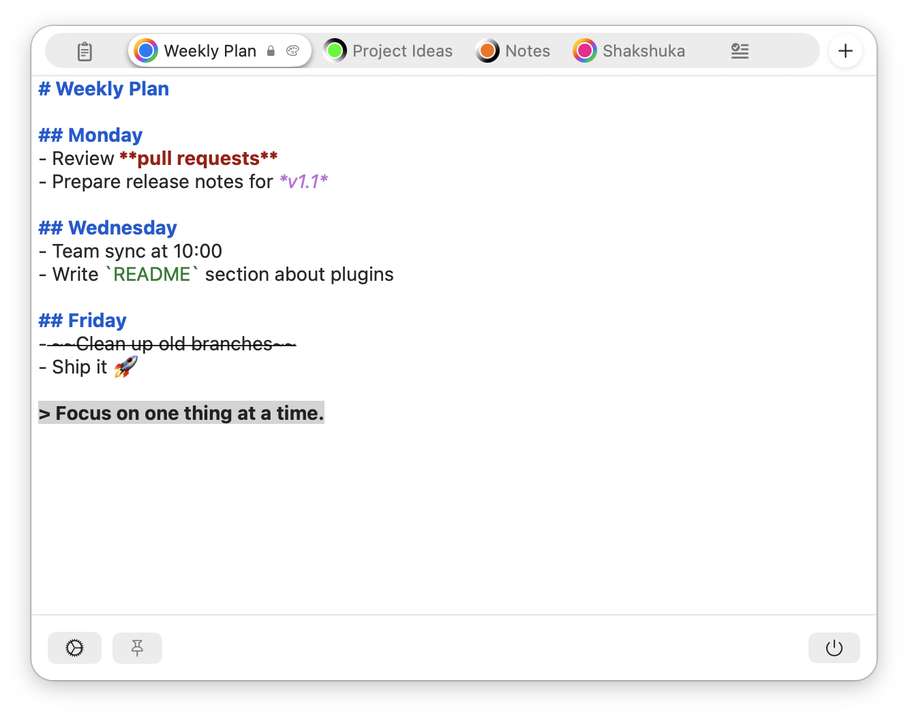
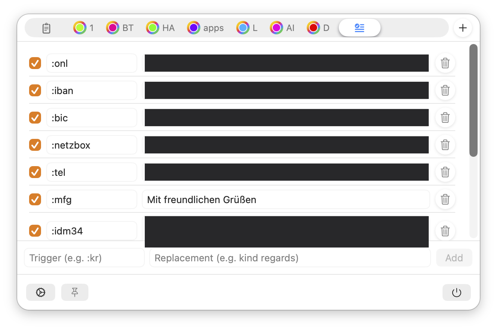
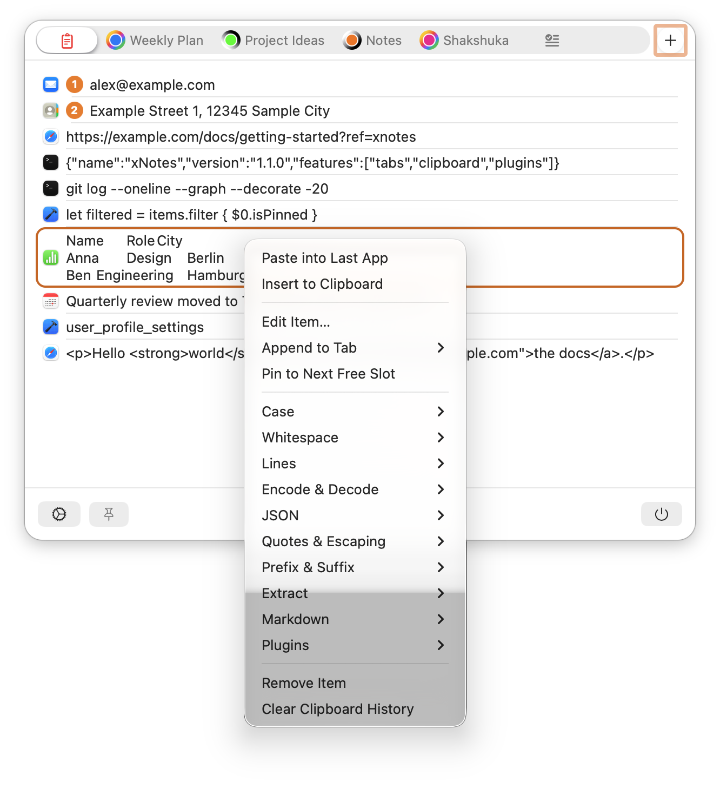

# xNotes

xNotes is a lightweight macOS menu bar notes app that keeps notes in colour-coded tabs, tracks a full clipboard history alongside them, and lets you cut repetitive typing with a built-in text expander. Define a short trigger, hint it with a snippet of any length — a signature, a standard reply, an address, a code block — and xNotes replaces the trigger with the full snippet the moment you type it, in whichever app you're working in.

<p align="center">
  
</p>

## Features
- Menu bar popover for fast access
- Multiple tabs with titles and colors
- Lock tabs to prevent accidental close
- Auto title from the first non-empty line
- Clipboard history tab (always visible)
- Pinned clipboard slots (max 9)
- Source app name and icon for clipboard items
- Clipboard item transformations (case, JSON, URL, Base64, line tools, etc.), grouped in submenus
- Extensible with your own transformations as JavaScript plugins — no rebuild needed
- Filter field in the clipboard-only panel
- Text expansion rules and quick inserts
- Search across tab titles, note content and clipboard history
- Export notes to text
- Backup export/import (JSON)
- Editor font, size, theme and line number settings
- Light and dark mode
- Optional "keep window open" pin

## Requirements
- macOS 14.0 Sonoma or later
- Apple Silicon only

## Installation

### Build from source
Open `xNotes.xcodeproj` in Xcode and run.

### Prebuilt DMG

A ready-to-run build is available as `xNotes.dmg` (ad-hoc signed, Apple Silicon only). Since it isn't notarized by Apple, macOS blocks it on first launch. Remove the quarantine flag before opening:

```bash
xattr -dr com.apple.quarantine /Applications/xNotes.app
```

Alternatively, right-click the app in Finder and choose "Open".

---

## Usage

### Text Expansion
- Define short triggers that expand into longer snippets
- Manage rules in the Text Expansion view

<p align="center">
  
</p>

### Clipboard
- New clipboard entries are captured automatically (text only)
- Duplicates are deduplicated; newest moves to top
- Pinned items stay at the top and are not removable
- Right-click an item for transformations and actions
- In the clipboard-only panel, type to filter; Return pastes the first match into the last app

<p align="center">
  
</p>

### Clipboard Transform Plugins
Every `.js` file in `~/Library/Application Support/de.adcore.xNotes/Transforms/` adds an entry to the clipboard context menu. Changes are picked up automatically. A README and three example plugins are created there on first launch (context menu ▸ Plugins ▸ Open Plugins Folder).

```js
/**
 * @title  Title Case
 * @group  Case                 (existing or new submenu; default "Plugins")
 * @input  Prefix:              (optional: asks for a value → ctx.argument)
 */
function transform(input, ctx) {
  return input.replace(/\b\w/g, c => c.toUpperCase()); // null/undefined = no change
}
```

Plugins run in an isolated JavaScript context without file or network access and are stopped after 3 seconds. `throw new Error("…")` shows the message in xNotes; files that fail to load are listed under Plugins ▸ Load Errors.

### Search
- `⌘F` searches tab titles, note content and clipboard history
- Every occurrence is a result; the match is highlighted in the editor, clipboard matches are selected in the list
- `Return` / `⌘G` next result, `⇧⌘G` previous result, `Esc` closes the search

### Shortcuts
- `⌘1` … `⌘9` select tabs 1–9
- `⌥1` … `⌥9` paste pinned clipboard slots 1–9 (when Clipboard tab is active)
- `⌘F` open search (or focus the filter in the clipboard-only panel)
- `⌘G` / `Return` next result
- `⇧⌘G` previous result
- `Esc` close search, then close the panel
- Right‑click the menu bar icon for export/backup/quit

### Backup
- Export full app state (tabs + clipboard) as JSON
- Import JSON backup to restore

### Permissions
- Pasting into other apps requires Accessibility permission for xNotes.

## Notes
- Notes and clipboard history are stored locally in `~/Library/Application Support/de.adcore.xNotes/tabs.json`. Versions before 1.1 used `UserDefaults` (key `savedNotes`); the data is migrated automatically on first launch.
- Settings and text expansion rules are stored in `UserDefaults`.

### Demo mode (development)
Debug builds started with the launch argument `-DemoMode YES` use sample data instead of your own notes, clipboard history and text expansion rules (clipboard monitoring and the text expander are disabled). Useful for screenshots.

---

## Third-Party Code

The Markdown editor (`xNotes/MarkdownEditor/`) is taken from [MarkdownEditor](https://github.com/dirkclemens/MarkdownEditor) (editor component only, without the preview), MIT licensed. xNotes-specific changes: configurable font, optional line numbers, search highlighting, focus handling and clickable links.

---

## License

This project is licensed under the [PolyForm Noncommercial License 1.0.0](https://polyformproject.org/licenses/noncommercial/1.0.0) — see [LICENSE](LICENSE) for details. Free for noncommercial use; commercial use requires a separate license from the author.
