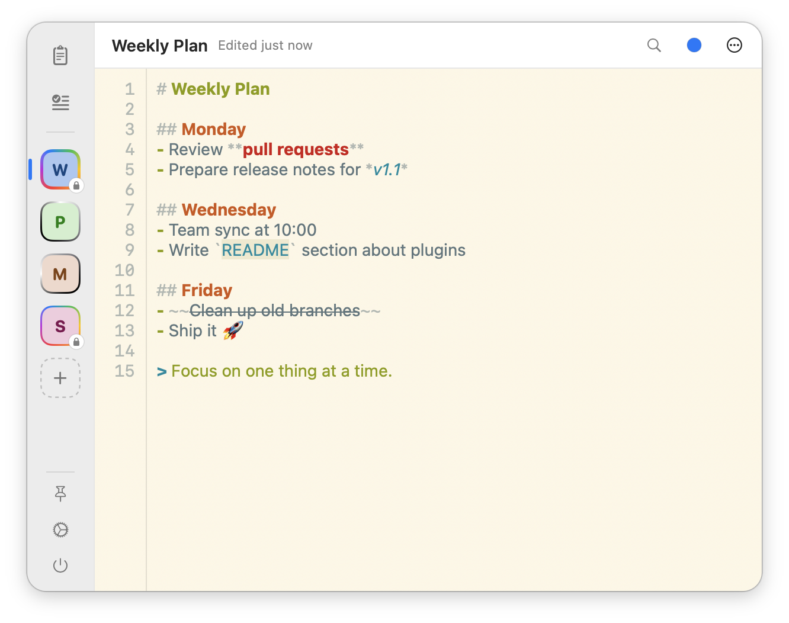
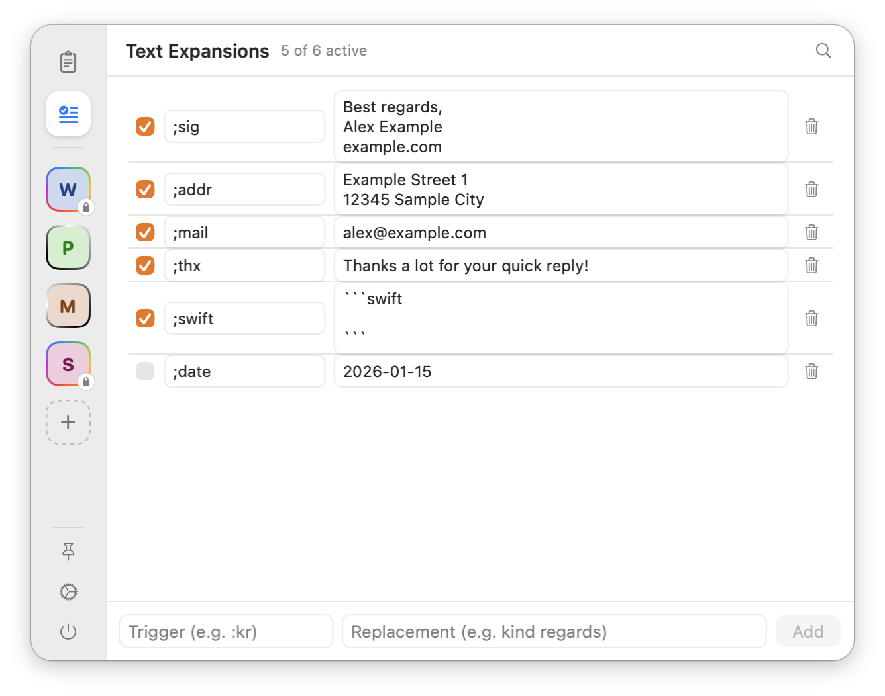
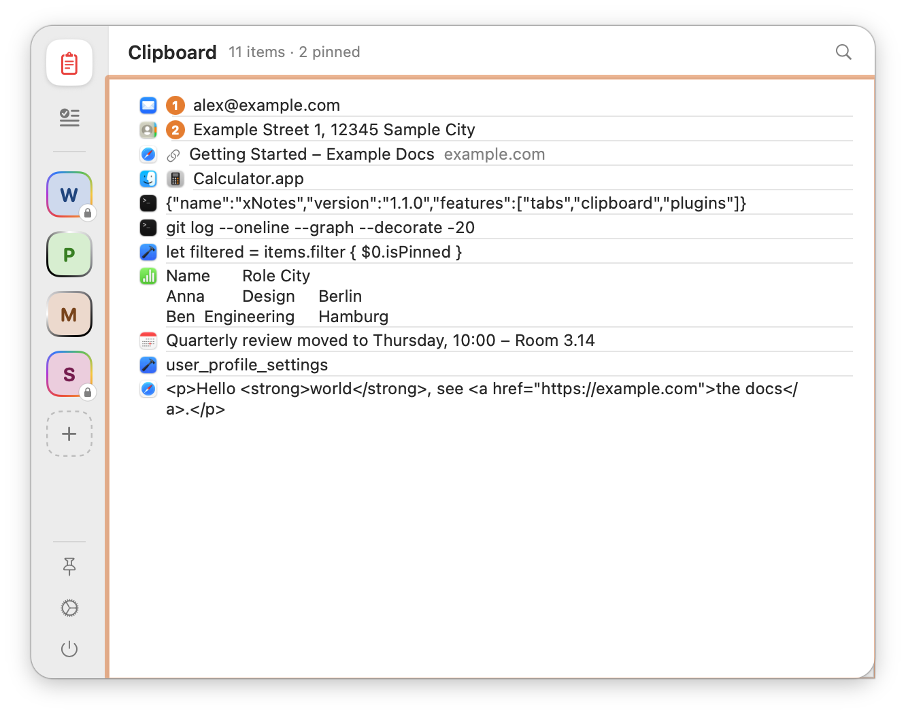

# xNotes

xNotes is a lightweight macOS menu bar notes app that keeps notes in colour-coded tabs, tracks a full clipboard history alongside them, and lets you cut repetitive typing with a built-in text expander. Define a short trigger, hint it with a snippet of any length — a signature, a standard reply, an address, a code block — and xNotes replaces the trigger with the full snippet the moment you type it, in whichever app you're working in.

<p align="center">
  
</p>

## Features
- Menu bar popover for fast access
- Multiple tabs with titles and colors in a slim sidebar (⌘1–⌘9, drag tiles to reorder); a context line shows title, last edit, color and tab actions
- Optional rainbow border around tabs that turns as auto-delete approaches; the context line and the tile tooltip show when an unlocked tab will be deleted
- Lock tabs to protect them from deletion; unlocked tabs are deleted automatically after a configurable number of days without edits (deleting always asks first, including unlocking a tab that is already past that period)
- Auto title from the first non-empty line
- Clipboard history tab (always visible)
- Pinned clipboard slots (max 9)
- Source app name and icon for clipboard items; hover for formats, size and more
- Clipboard keeps images, files, formatting (RTF, HTML) and links with titles; skips passwords marked as sensitive
- Clipboard item transformations (case, JSON, URL, Base64, line tools, etc.), grouped in submenus
- Extensible with your own transformations as JavaScript plugins — no rebuild needed
- Filter field in the clipboard-only panel
- Text expansion rules and quick inserts
- Search across tab titles, note content and clipboard history
- Export notes to text and backup export/import (JSON) in Settings, file names dated YYYYMMDD
- Menu bar right-click menu with the latest clipboard entries (count configurable)
- Editor font, size, theme and line number settings
- Light and dark mode
- Optional "keep window open" pin

## Requirements
- macOS 14.0 Sonoma or later
- Apple Silicon only

## Installation

### Build from source
Open `xNotes.xcodeproj` in Xcode and run.

### Prebuilt DMG

A ready-to-run build is available as `xNotes.dmg` (ad-hoc signed, Apple Silicon only). Since it isn't notarized by Apple, macOS blocks it on first launch. Remove the quarantine flag before opening:

```bash
xattr -dr com.apple.quarantine /Applications/xNotes.app
```

Alternatively, right-click the app in Finder and choose "Open".

---

## Usage

### Text Expansion
- Define short triggers that expand into longer snippets
- Manage rules in the Text Expansion view

<p align="center">
  
</p>

### Clipboard
- New clipboard entries are captured automatically (text, formatted text, files and images)
- Images (screenshots, "Copy Image") are kept as PNG with a thumbnail in the list; paste them back, open them in Preview or save them. Settings ▸ Clipboard ▸ Save Images turns this off. Images are stored in `ClipboardImages/` next to `tabs.json` and are not part of backups
- Formatting (RTF, HTML) is kept and pasted along unless Settings ▸ Clipboard ▸ Paste as Plain Text is on; the context menu offers the other variant per item. Edited or transformed entries paste as plain text. Formatted versions are stored next to `tabs.json` in `ClipboardRichText/` and included in backups
- Files copied in the Finder are kept as files: pasting puts the files back (e.g. into a Finder window or a mail), "Show in Finder" reveals them, "Append to Tab" adds their paths
- Duplicates are deduplicated; newest moves to top
- Pinned items stay at the top and are not removable
- Links show their page title (when the source app provides one, e.g. Safari) and domain; the context menu opens them or pastes/copies them as Markdown links `[Title](url)`, and "Append to Tab" adds them as Markdown links. If the title is unknown, these actions load the page once to read it (falling back to the domain) and keep it
- Copied links are saved without tracking parameters (`utm_*`, `fbclid`, `gclid`, Amazon `ref=…` and similar); parameters a page needs are kept. Can be turned off in Settings ▸ Clipboard
- Hover over an item to see its source app, time, copied formats and size
- Passwords marked as sensitive by password managers, and copies from Apple's Passwords app or Keychain Access, are not recorded (Settings ▸ Clipboard ▸ Save Sensitive Entries); entries marked as temporary or auto-generated are never recorded ([nspasteboard.org](http://nspasteboard.org) convention)
- Right-click an item for transformations and actions
- In the clipboard-only panel, type to filter; Return pastes the first match into the last app

<p align="center">
  
</p>

### Clipboard Transform Plugins
Every `.js` file in `~/Library/Application Support/de.adcore.xNotes/Transforms/` adds an entry to the clipboard context menu. Changes are picked up automatically. A README and three example plugins are created there on first launch (context menu ▸ Plugins ▸ Open Plugins Folder).

```js
/**
 * @title  Title Case
 * @group  Case                 (existing or new submenu; default "Plugins")
 * @input  Prefix:              (optional: asks for a value → ctx.argument)
 */
function transform(input, ctx) {
  return input.replace(/\b\w/g, c => c.toUpperCase()); // null/undefined = no change
}
```

Plugins run in an isolated JavaScript context without file or network access and are stopped after 3 seconds. `throw new Error("…")` shows the message in xNotes; files that fail to load are listed under Plugins ▸ Load Errors.

### Search
- `⌘F` searches tab titles, note content and clipboard history
- Every occurrence is a result; the match is highlighted in the editor, clipboard matches are selected in the list
- `Return` / `⌘G` next result, `⇧⌘G` previous result, `Esc` closes the search

### Shortcuts
- `⌘1` … `⌘9` select tabs 1–9
- `⌥1` … `⌥9` paste pinned clipboard slots 1–9 (when Clipboard tab is active)
- `⌘F` open search (or focus the filter in the clipboard-only panel)
- `⌘G` / `Return` next result
- `⇧⌘G` previous result
- `Esc` close search, then close the panel
- Right‑click the menu bar icon for the latest clipboard entries and Quit (number of entries: Settings ▸ Clipboard)

### Export & Backup
In Settings ▸ Export & Backup:
- Export all notes as text (to the Desktop or a location of your choice)
- Export full app state (tabs + clipboard) as JSON
- Import JSON backup to restore

### Permissions
- Pasting into other apps requires Accessibility permission for xNotes.

## Notes
- Notes and clipboard history are stored locally in `~/Library/Application Support/de.adcore.xNotes/tabs.json`. Versions before 1.1 used `UserDefaults` (key `savedNotes`); the data is migrated automatically on first launch.
- Settings and text expansion rules are stored in `UserDefaults`.

### Demo mode (development)
Debug builds started with the launch argument `-DemoMode YES` use sample data instead of your own notes, clipboard history and text expansion rules (clipboard monitoring and the text expander are disabled). Useful for screenshots.

---

## Third-Party Code

The Markdown editor comes from the Swift package [MarkdownEditorKit](https://github.com/dirkclemens/MarkdownEditorKit), MIT licensed, which is shared with [MarkdownEditor](https://github.com/dirkclemens/MarkdownEditor). Xcode resolves it automatically when building.

---

## License

This project is licensed under the [PolyForm Noncommercial License 1.0.0](https://polyformproject.org/licenses/noncommercial/1.0.0) — see [LICENSE](LICENSE) for details. Free for noncommercial use; commercial use requires a separate license from the author.
